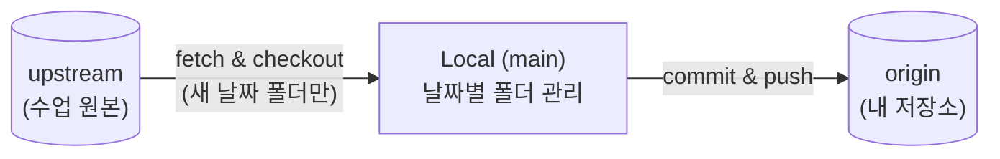

 

# 🚀 함께 성장하는 AI 개발 여정

### 🌱 작은 시작이 모여 큰 성장을 만듭니다.

**Learn · Challenge · Grow · Together**

프로젝트 기간: 2026.10.19(월) ~ 2027.03.04(목)  
전체 인원 : 30명  

---

## 🔀 Git 관리 구조

---

## 💌 수강생 여러분께

처음부터 잘하는 사람은 없습니다.

중요한 것은 **포기하지 않고, 스스로 고민하고, 끝까지 도전하는 자세**입니다.

실수해도 괜찮고, 조금 느려도 괜찮습니다.  
오늘 해결하지 못한 문제가 내일의 성장으로 이어질 것입니다.

이곳의 실습 자료들이 여러분의 성장에 작은 디딤돌이 되기를 바랍니다.

**여러분의 가능성을 믿고, 모든 도전을 응원합니다!** 💪

---

### ✨ Keep Learning, Keep Growing, Keep Challenging! ✨

**여러분의 오늘보다 더 멋진 내일을 응원합니다.**

Made with ❤️ for Future AI Developers

